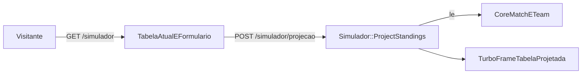

# ADR 0003 — Simulador: classificação "e se"

- Status: aceito · Data: 2026-10-31
- Fonte: TICKET-0026 + grill (2 rodadas, respostas do usuário)
- Relação: complementa o ADR 0001 (engine `simulador`, "read-only sobre core") sem alterá-lo

## 1. Problema
O Simulador está no título da spec ("Bolão · Cartola · Simulador") e na árvore do ADR 0001 (`engines/simulador/ Simulation (read-only sobre core)`), mas não tem contrato: a spec v3 não descreve fluxo, dados nem saída, e `engines/simulador` só tem os arquivos gerados (`application_*`). Sem uma decisão, nenhum ticket do Simulador pode ser escrito, e o produto entrega só duas das três partes prometidas.

## 2. Fluxo do usuário
1. O visitante, logado ou não, abre `GET /simulador`, que mostra o campeonato mais recente (maior `season`); um seletor troca de campeonato.
2. A página mostra a tabela real atual e, abaixo, um formulário com os jogos `scheduled` e `live`, agrupados por rodada. Jogos `live` já vêm preenchidos com o placar atual. Jogos `finished`, `scored` e `reverted` não são editáveis e entram com o placar real.
3. O visitante preenche os placares que quiser. Os atalhos opcionais "preencher em branco com empate" e "mandante vence" só preenchem campos e não mudam a regra.
4. Ao enviar, `POST /simulador/projecao` calcula e devolve a tabela projetada num Turbo Frame, sem recarregar a página. Nada é gravado.

## 3. Modelo de dados
- Sem tabelas novas e sem migration na engine `simulador`.
- `Simulador::Simulation` é um `Data.define(:championship, :guesses)` em memória, e não um model ActiveRecord. Isso diverge da palavra "Simulation" na árvore do ADR 0001; o desvio fica registrado aqui, e o ADR 0001 não muda.
- `guesses`: hash `match_id => [home, away]`, aceito só para partidas `scheduled`/`live` do campeonato escolhido. Valores inteiros ≥ 0; os inválidos são descartados com erro por campo.
- Leitura: `Core::Match` (placar, status, `round`) e `Core::Team`. A engine depende só de `engines/core`, como o packwerk já impõe.
- Pré-requisito: `core_matches.round` (ticket derivado 0028). Hoje a rodada só pode ser derivada do `external_id` dos seeds (`br26-rNN-…`), o que não vale para dados importados por CSV.

## 4. Output
- Tabela projetada renderizada com `Ui::StandingsTableComponent` (posição, jogos, V/E/D, saldo, pontos), com os 4 estados do design system.
- Variação de posição em relação à tabela real (subiu, desceu ou manteve), com glifo e tint, sem cor como único sinal.
- Faixas de zona: título (1º), G4 (2º–4º), G6 (5º–6º) e Z4 (17º–20º).
- Desempate: pontos, vitórias, saldo de gols, gols pró e nome do time. Confronto direto e cartões ficam fora da v1, porque não há dados de cartões e o confronto direto entre 3 ou mais times complica sem ganho real.
- Jogo restante sem placar hipotético fica fora da tabela; não vira empate nem é sorteado.
- Sem gráficos na v1, porque a evolução por rodada exigiria histórico.

## 5. Gratuidade
- Grátis e público: não exige login, não tem anúncio nem recurso pago.
- Sem persistência, o Simulador não cria registro nenhum, nem para visitantes anônimos. O único dado pessoal tratado é o IP, que fica no contador do `rate_limit` (Solid Cache) só durante a janela de 1 minuto. Não há nada a anonimizar no `Users::AnonymizeService`.

## 6. Free tier
| recurso | limite relevante | uso pelo Simulador |
|---|---|---|
| Render web free | 512 MB, dorme sem tráfego | cálculo síncrono em memória: 380 partidas × 20 times em menos de 50 ms por requisição |
| Render worker / Solid Queue | free roda o Solid Queue dentro do Puma (`SOLID_QUEUE_IN_PUMA=1`) | nenhum job |
| Neon free | storage e horas de compute limitados | só leitura: 1 query de partidas + 1 de times por cálculo; zero escrita |
| Solid Cache | mesmo banco | tabela real por campeonato, com chave por `championship_id` + `maximum(:updated_at)`; contador do `rate_limit` |

- `GET /simulador` usa `fresh_when` (ETag pelo `updated_at` máximo das partidas), então repetir a visita custa 304.
- `POST /simulador/projecao` tem `rate_limit to: 30, within: 1.minute, by: -> { request.remote_ip }`; acima disso, responde 429 com mensagem no frame.

## 7. Alternativas
| | A — classificação "e se" | B — Monte Carlo da temporada | C — A agora, B depois |
|---|---|---|---|
| o que é | o usuário informa placares hipotéticos e vê a tabela projetada | N simulações (Poisson por força de ataque e defesa) dos jogos restantes; probabilidade de título, G4 e Z4 | entrega A e deixa B como evolução |
| custo | baixo: 1 service puro + 1 tela | alto: modelo de força, job, cache por rodada, recálculo a cada partida | A + B |
| risco | baixo; regra determinística e fácil de testar | médio/alto: CPU e worker no free tier; o resultado depende da calibração do modelo | o risco de B fica adiado, mas o compromisso também |
| cobre o problema? | sim: dá contrato ao Simulador com o menor custo | sim, mas com uma pergunta diferente ("quais as chances?") | sim |

## 8. Decisão
**Alternativa A — classificação "e se"**, pública, sem persistência e calculada de forma síncrona. Ela cabe nas seções 5 e 6: é grátis para o usuário, não usa worker nem escreve no Neon, e o custo por requisição é limitado pelo rate limit por IP. B fica no backlog (seção 9), condicionado ao free tier, e não como compromisso. Por isso esta decisão não é C.

### Sessão grill
Rodada 1:

| # | pergunta | recomendação | resposta |
|---|---|---|---|
| Q1 | persistência na v1? | sem tabela; `Simulation` em memória | aceita |
| Q2 | quem acessa? | só usuário logado | **recusada: público** |
| Q3 | como agrupar por rodada sem `round`? | ticket derivado adicionando `core_matches.round` | aceita |
| Q4 | jogo restante em branco? | não conta; atalhos opcionais | aceita |
| Q5 | desempate? | pontos, vitórias, saldo, gols pró, nome | aceita |
| Q6 | integrar com Bolão/Cartola? | não | aceita |
| Q7 | execução? | síncrona, cache, rate limit, sem job | aceita |
| Q8 | saída? | tabela + variação de posição + zonas, sem gráficos | aceita |

Rodada 2 (aberta pela resposta pública da Q2):

| # | pergunta | recomendação | resposta |
|---|---|---|---|
| R2-Q1 | rate limit sem usuário? | 30/min por IP, sem captcha | aceita |
| R2-Q2 | fluxo HTTP? | GET com `fresh_when` + POST devolvendo Turbo Frame | aceita |
| R2-Q3 | qual campeonato? | o mais recente, com seletor | aceita |
| R2-Q4 | quais jogos são editáveis? | só `scheduled`/`live` | aceita |
| R2-Q5 | onde fica o código? | service puro na engine + UI no app host | aceita |
| R2-Q6 | tickets derivados? | 0028, 0029 + 2 itens de backlog | aceita |

### Objeções respondidas
1. **"Uma página pública vai consumir o free tier."** O cálculo não toca o banco além de 2 leituras; o GET responde 304 via ETag; o POST tem limite de 30/min por IP. O pior caso por IP é 30 cálculos de menos de 50 ms por minuto, sem job.
2. **"Não dá para agrupar por rodada: `core_matches` não tem `round`."** Derivar do `external_id` só funciona com os seeds, e agrupar pela semana de `match_date` quebra com jogos adiados. A rodada é um dado de domínio do core, por isso entra como ticket derivado (0028) e é pré-requisito do 0029; Bolão e Cartola também ganham com ela.
3. **"Sem persistência, o usuário perde a simulação ao sair."** É uma troca aceita na v1, para manter o Simulador sem dado pessoal e sem escrita. "Salvar ou compartilhar simulação" fica no backlog, e uma URL compartilhável pode ser feita sem banco.
4. **"Seria mais útil simular os pontos do Bolão ou do Cartola."** O ADR 0001 proíbe dependência entre engines, e o packwerk barra. O preview do Bolão por placar candidato já existe no admin (TICKET-0006/0010).
5. **"Monte Carlo responde melhor 'quem cai?'."** Responde, mas exige job e CPU recorrentes e um modelo calibrado, o que o free tier não comporta com folga. Fica no backlog, condicionado a medir o custo.

## 9. Tickets derivados
| ticket | título | deps | escopo |
|---|---|---|---|
| 0028 | `core_matches.round` | 0002, 0009 | migration em `engines/core` (`round` integer, check 1..38, índice `(championship_id, round)`); seeds preenchem a partir do round-robin; import CSV lê a coluna `round` |
| 0029 | Simulador v1 "e se" | 0028, 0011 | `Simulador::ProjectStandings` (service puro na engine, só Core) + `Simulador::Simulation` (`Data.define`); controller público no app host (`allow_unauthenticated_access`, policy que aceita `user` nil, `rate_limit` por IP, `fresh_when`); componentes de formulário por rodada e tabela projetada com variação e zonas, com 4 estados e previews no Lookbook |
| backlog | Salvar/compartilhar simulação | 0029 | URL compartilhável sem banco ou persistência por usuário; decidir em ADR próprio |
| backlog | Monte Carlo da temporada | 0029 | só se uma medição no free tier mostrar folga de CPU/worker |
